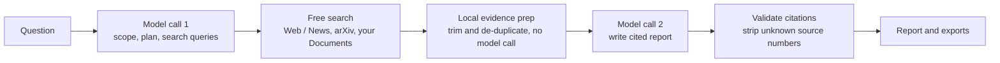

<div align="center">

# ResearchAI

**Turn complex questions into clear, evidence-backed reports with numbered, clickable citations.**


</div>

ResearchAI is an AI research workspace built with Streamlit. Ask a question, and it searches the live web and news, academic papers and your own documents, then writes a structured report where every factual statement points back to a source.

It is designed to be **cheap to run** (two model calls per report, free search sources) and **honest about what it knows** (sourced facts are separated from AI interpretation, and nothing is marked "verified" unless it was).

---

## Features

| Area | What you get |
|---|---|
| **Research workspace** | One question box, depth selector (Quick / Standard / Deep Research), source selector, output format (Summary / Detailed Report / Comparison) |
| **Live progress** | Six real pipeline stages with an activity log. The progress bar only moves when a backend stage actually finishes |
| **Cited reports** | Executive summary, key takeaways, detailed sections, comparison tables, limitations and follow-up questions. Citations like `[3]` link to the source |
| **Fact vs. interpretation** | Sourced statements carry citations. The model's own reasoning is labelled "AI interpretation" |
| **Free real-time sources** | Google News RSS and DuckDuckGo for web and news, arXiv for papers. Optional Tavily for higher quality |
| **Your documents** | Upload PDF, Word (.docx), text or Markdown files and research them alongside other sources |
| **History and library** | Searchable research history, saved reports, and a sources library across all your research |
| **Export** | Download any report as Markdown or JSON |
| **Cost control** | Two model calls per run, a cheap default model, result reuse for repeated questions, and a token and cost readout per report |
| **Paper Summarizer** | The original single-paper summarizer, kept as its own page |
| **Demo mode** | Preview the whole interface with clearly labelled sample data, no API key needed |

## How it works



1. **Scope and plan** (model call 1): restates the question, defines scope, and writes short search queries. The model is given today's date so "today" and "latest" work.
2. **Search** (free): each connected source is searched. If one source fails, the others still run.
3. **Evidence prep** (no model call): results are de-duplicated and trimmed to keep token cost low.
4. **Write the report** (model call 2): the model may only use the listed sources and must cite them by number. It is told to say so when sources are missing, conflicting or outdated.
5. **Validate**: any citation that does not match a real source is removed before the report is shown.

## Quick start

**Requirements:** Python 3.11 or newer, and an OpenAI API key with credit.

### With uv (fastest)

```bash
git clone https://github.com/mayank341/Research-assistant.git
cd Research-assistant

uv venv --python 3.12
# Windows (PowerShell):  .venv\Scripts\Activate.ps1
# macOS / Linux:         source .venv/bin/activate

uv pip install -r requirements.txt
```

### With pip

```bash
python -m venv .venv
# Windows (PowerShell):  .venv\Scripts\Activate.ps1
# macOS / Linux:         source .venv/bin/activate

pip install -r requirements.txt
```

### Configure and run

Create a `.env` file in the project root:

```env
OPENAI_API_KEY=sk-...
OPENAI_MODEL=gpt-4o-mini
# Optional: better web search quality (https://tavily.com)
# TAVILY_API_KEY=tvly-...
```

```bash
streamlit run app.py
```

No API key yet? Open **Settings** and switch on **Demo mode** to explore the interface with sample data.

## Configuration

| Variable | Required | Purpose |
|---|---|---|
| `OPENAI_API_KEY` | Yes (not for demo mode) | Used for the two model calls per report |
| `OPENAI_MODEL` | No | Defaults to `gpt-4o-mini`, a low-cost model |
| `TAVILY_API_KEY` | No | Uses Tavily for web search instead of DuckDuckGo |

Keys are read from environment variables and are never displayed in the app. `.env` is listed in `.gitignore` and must not be committed.

## Using it

1. **Dashboard**: type a question, pick depth, sources and format, then **Start Research**.
2. **Sources**: choose **Web** for news and current events, **Academic** for research papers, **Documents** for your own files, or **All Sources**.
3. **Documents page**: upload files first, then choose **Documents** or **All Sources**.
4. **Report**: use the Overview, Detailed Report, Sources and Research Activity tabs. Click a citation to open its source.
5. **Follow-ups**: use **Investigate** on a suggested question, or **Refine and rerun** for a fresh run of the same research.

## Keeping API cost low

- Only **two** model calls per report. Search and evidence prep are free and local.
- Default model is `gpt-4o-mini`. A typical report is roughly a tenth of a cent to half a cent. This is an estimate, and the **Research Activity** tab shows the real token counts for each run.
- The same question is reused from history instead of re-running: 15 minutes for Web, 24 hours for other sources. Disable this in **Settings**.
- **Quick** depth is the cheapest and fastest.
- API usage is billed separately from any ChatGPT subscription.

## Project structure

```
research_ai/
├── app.py                      # Entry point and page routing
├── requirements.txt
├── template.json               # Prompt template used by Paper Summarizer
├── .streamlit/config.toml      # Theme and server settings
├── assets/logo.svg
├── components/                 # UI
│   ├── sidebar.py
│   ├── research_input.py       # Workspace, input form, suggestions
│   ├── progress.py             # Live execution view
│   ├── report_view.py          # Report tabs and exports
│   ├── source_cards.py         # Source cards and library
│   ├── documents.py            # Document upload and management
│   ├── history.py              # History and saved reports
│   ├── settings.py
│   └── summarizer.py           # Paper Summarizer page
├── services/                   # Backend logic
│   ├── research_service.py     # Research pipeline and search providers
│   ├── documents.py            # Local document parsing and search
│   ├── paper_summarizer.py     # Original summarizer logic
│   ├── storage.py              # JSON persistence
│   ├── demo_data.py            # Labelled sample data
│   └── llm.py                  # Model setup
└── utils/
    ├── styles.py               # Design system
    └── state.py                # Session state helpers
```

Reports and settings are stored in `data/store.json`, and parsed documents in `data/docs/`. Both are created on first use and ignored by Git.

## Deploying on Streamlit Community Cloud

1. Push this repo to GitHub (keep `.env` and `data/` out of it).
2. At [share.streamlit.io](https://share.streamlit.io), click **Create app** and select the repository, branch `main`, and main file `app.py`.
3. In **Advanced settings**, choose Python 3.12 and add your secrets:
   ```toml
   OPENAI_API_KEY = "sk-..."
   OPENAI_MODEL = "gpt-4o-mini"
   ```
4. Click **Deploy**.

**Before sharing a public link:**
- Anyone who can open the app can spend your API credit. Restrict viewer access in the app's sharing settings.
- The app is single-user. Visitors share the same history and documents.
- Saved reports and uploaded documents are lost whenever the cloud app restarts or redeploys.

## Limitations

- **Evidence depth:** claims are drawn from titles, abstracts, headlines, snippets and document passages. Full web pages and full papers are not read.
- **No independent fact-checking.** Always open the cited source to confirm important details.
- **Live information** such as sports scores comes from headlines and snippets and can be incomplete or slightly out of date.
- **Scanned PDFs** (image-only) are not supported, because there is no OCR.
- **Search sources** can be rate-limited or change their format, and results vary by query.
- **Long jobs:** closing the browser tab stops a running research job. Use **Retry** to run it again.

## Roadmap

- Fetch and read full pages for the top sources
- OCR for scanned documents
- Login and per-user storage for shared deployments
- Optional free or local model backends to remove API cost
- PDF and Word report export

## Tech stack

Python, Streamlit, LangChain (`langchain-openai`), OpenAI API, arXiv API, Google News RSS, DuckDuckGo (`ddgs`), `pypdf`, `python-docx`.
# Running web live link :

https://your-research-ai-assistant.streamlit.app/
## Author

Built by **Mayank**.

## License

Add a `LICENSE` file to the repository (for example MIT) to state how others may use this code.
